# Dollique 🧸

> **Dollique** is a Q&A community for doll customizers, OOAK (One Of A Kind) artists and figure collectors: people ask about repaints, reroots, sealants and joint repairs, check if a figure is legit, share restoration guides and vote for the most useful answers. Every member also dresses up their own pixel doll, and it can stand in for their avatar.

Built for the **USOF Challenge**, Full Stack track: Part 1 is the REST API (`API/`), Part 2 is the React website (`web/`).

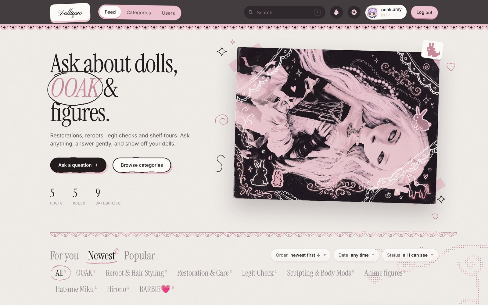

---

## Contents

- [Features](#features)
- [Screenshots](#screenshots)
- [Tech stack](#tech-stack)
- [Requirements](#requirements)
- [How to run](#how-to-run)
- [Project structure](#project-structure)
- [How the website works](#how-the-website-works)
- [How the API works](#how-the-api-works)
- [Database](#database)
- [API reference](#api-reference)
- [Progress by CBL stages](#progress-by-cbl-stages)

---

## Features

### Website (Part 2)

**Required by the task**
- Main page with the latest posts first; sorting by date or likes, both directions; filters by categories, date range and status; pagination.
- Header with the service name, search, the user's role, login and avatar (a link to the profile) and log out. On phones the login, role and log out move into the menu.
- Sign up, sign in by login or email, email confirmation, password reset by email, log out.
- Post page with all its fields, photos, likes / dislikes and comments: create, edit, delete, reply, like and dislike. Comments are sorted by likes ascending by default.
- Create and edit posts with categories and up to 5 photos; post previews in the feed show every field of a post.
- Profile pages, a members list, a categories page, account settings.
- Admin tools: in the admin panel and right on the site (hide or delete any post, change its categories, delete any comment, ban users, approve categories).
- Responsive layout from 360 px phones to wide screens, without sideways scrolling.

**Extra (creative part)**
- **Dress-up doll.** At sign up you make a doll first (body, hair, outfit, shoes, up to 3 accessories), then the account. The doll can be shown instead of the profile photo everywhere on the site.
- **"For you" feed** from the categories you follow.
- **Live updates.** New posts, comments, likes and categories show up in every open tab in under a second, without reloading.
- **Notifications** in a bell and on their own page: replies, comments, likes, moderation decisions, strikes and bans.
- **Moderation with appeals** on the post page: the author sees why a post was hidden and can appeal, an admin approves or rejects it right there.
- **Saved posts**, share link, related posts, a date range calendar, our own dropdowns and confirm dialogs.
- **Email change with confirmation:** the old email keeps working until the new one is confirmed.
- Hand-made look: paper, frosted glass cards, pink lace, pixel icons, hand-drawn buttons. No UI libraries.

### API (Part 1)

- Registration with email confirmation, login by login or email, logout, password reset by email.
- Users, posts, categories, comments, likes / dislikes on posts and comments, with full CRUD; roles `user` and `admin`.
- Inactive posts and comments are visible only to their author and admins.
- User rating is calculated automatically from the likes and dislikes on their posts and comments.
- Moderation: hidden posts with a reason, appeals, automatic deletion, strikes and auto-ban, user-suggested categories, the doll parts catalog.
- Security: bcrypt passwords, JWT that is revoked on logout and password change, a login attempt limiter, validation of every input.
- The database is recreated by one command and seeded with at least 5 rows in every table.

---

## Screenshots

| | |
| :---: | :---: |
| 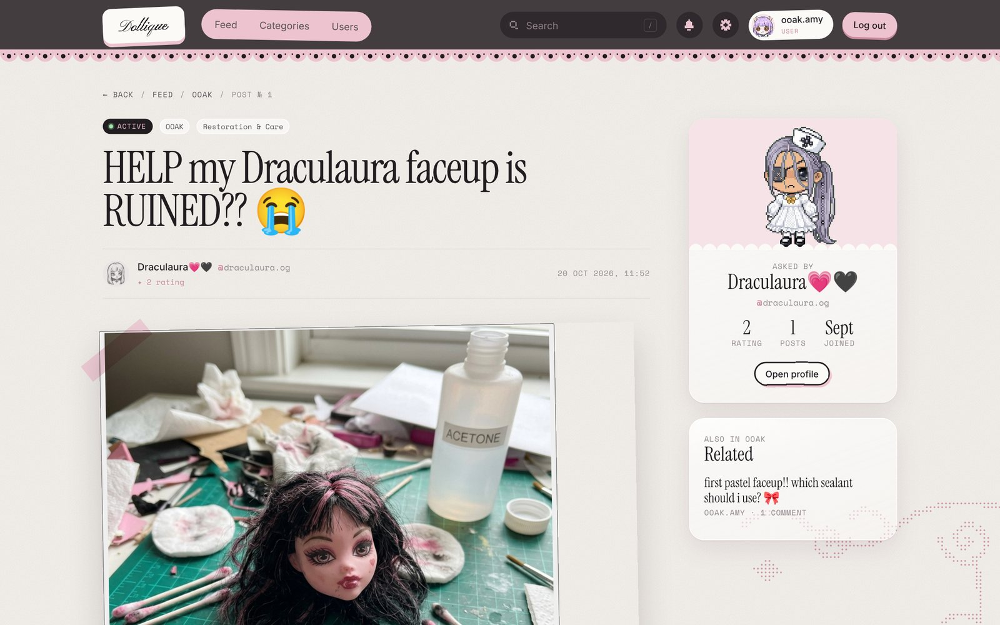 | 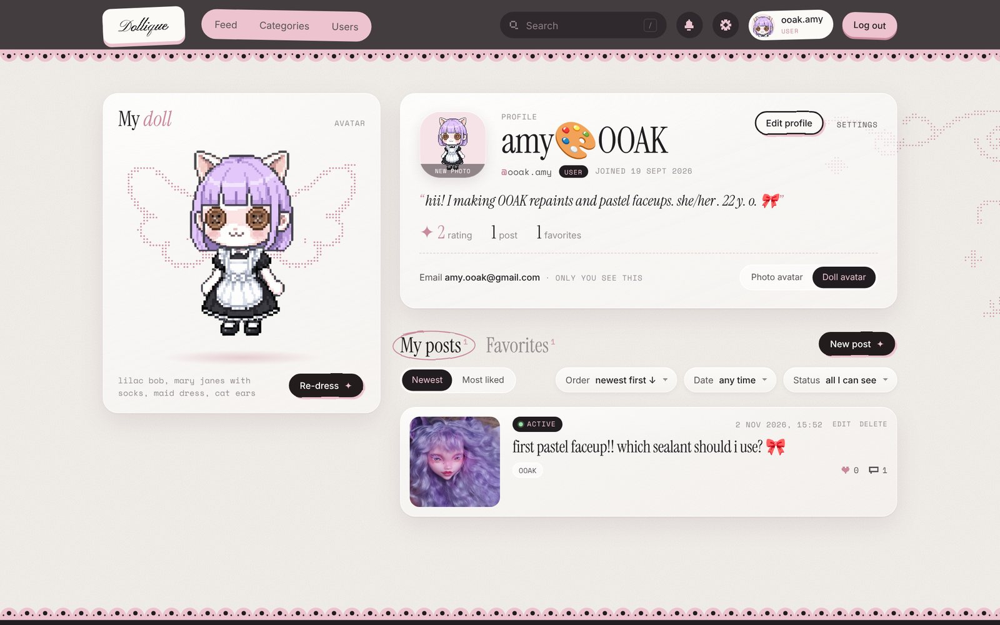 |
| Post with photos, votes and comments | Profile with the doll and the user's posts |
| 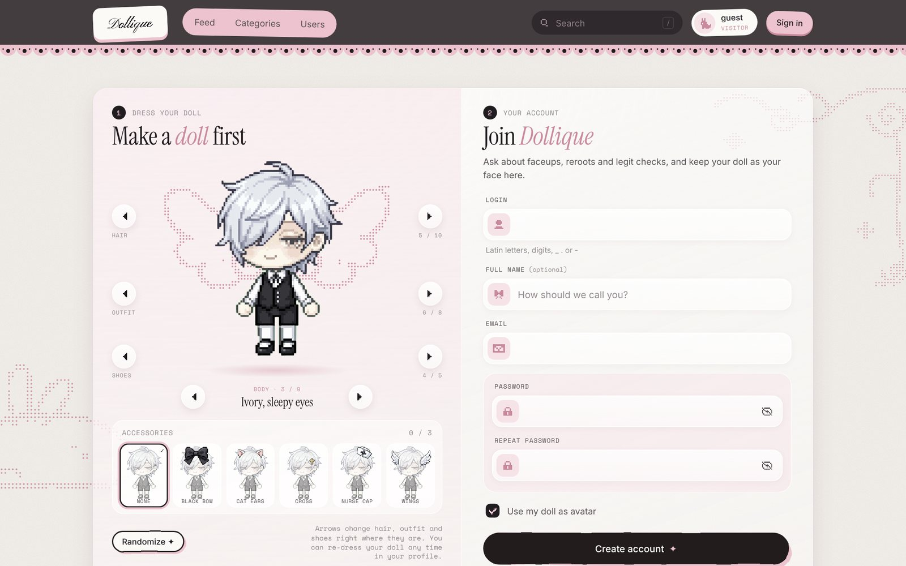 | 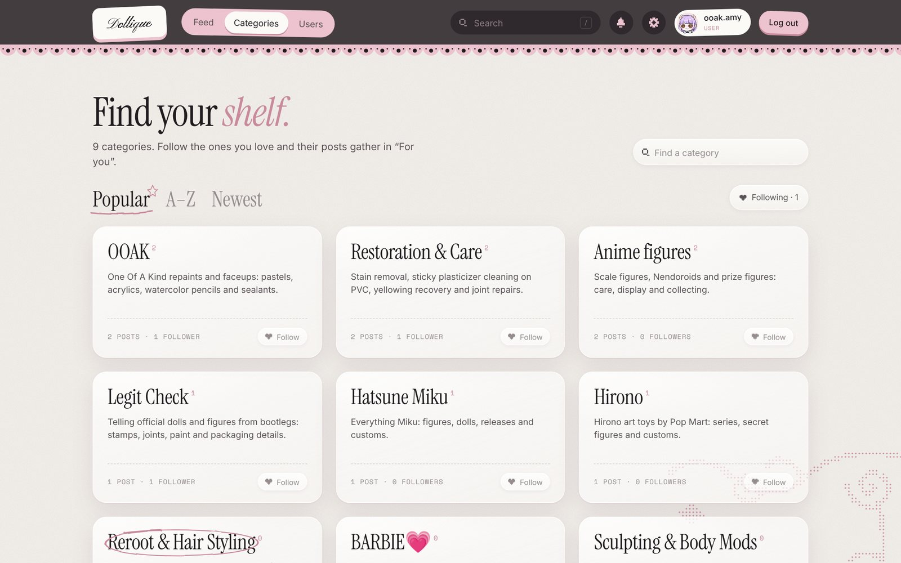 |
| Sign up: make a doll first | Categories with follow buttons |
| 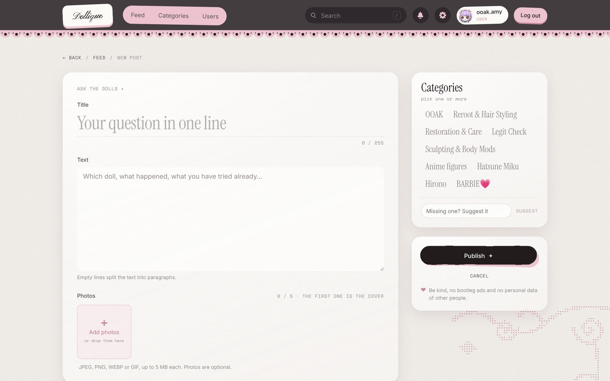 | 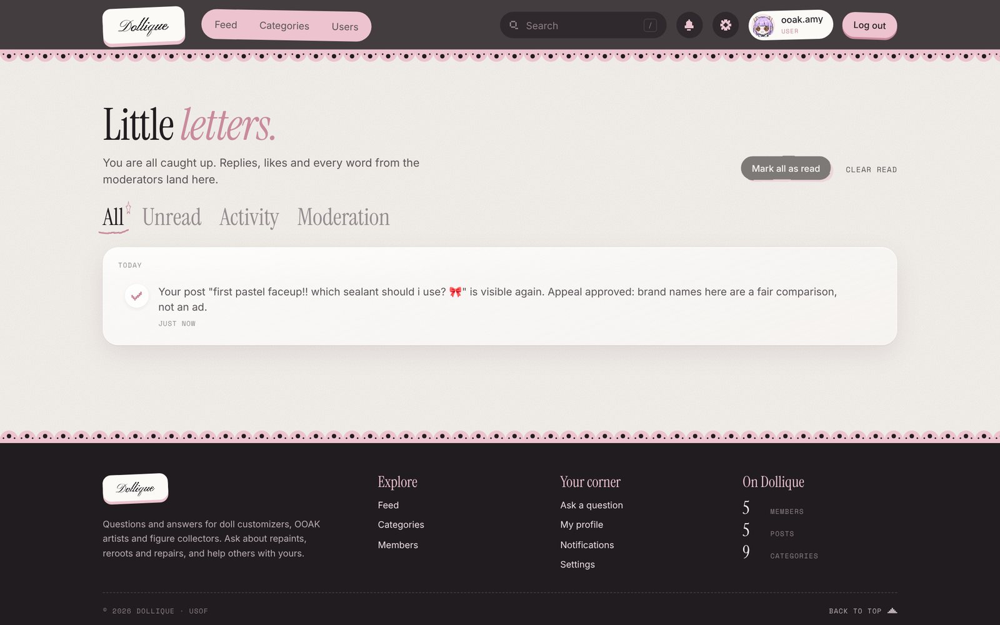 |
| New post | Notifications |

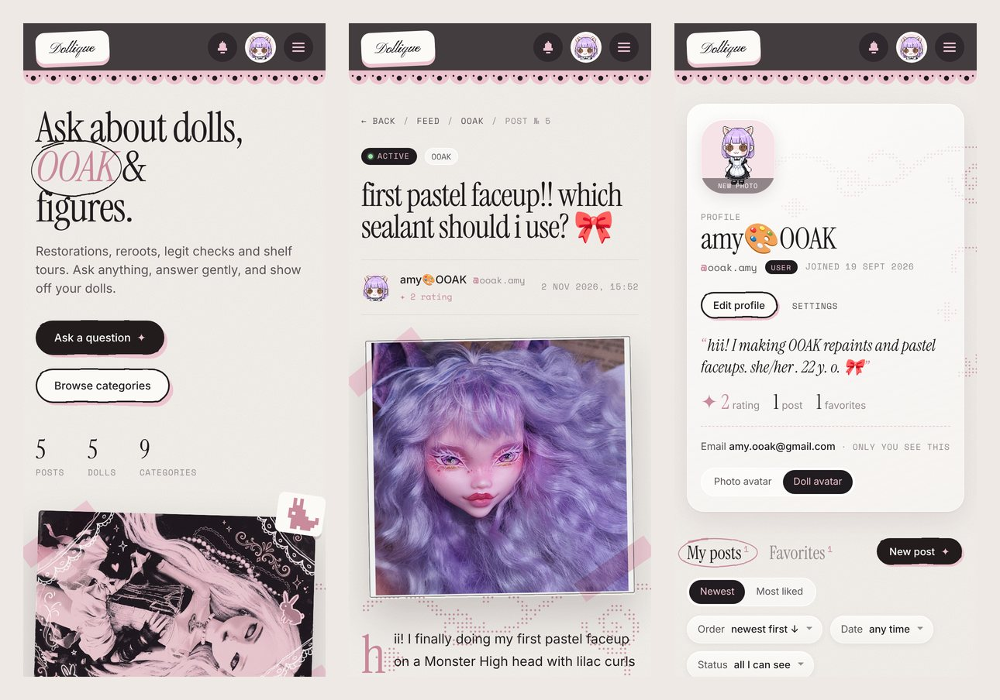

**Admin panel**

| | |
| :---: | :---: |
| 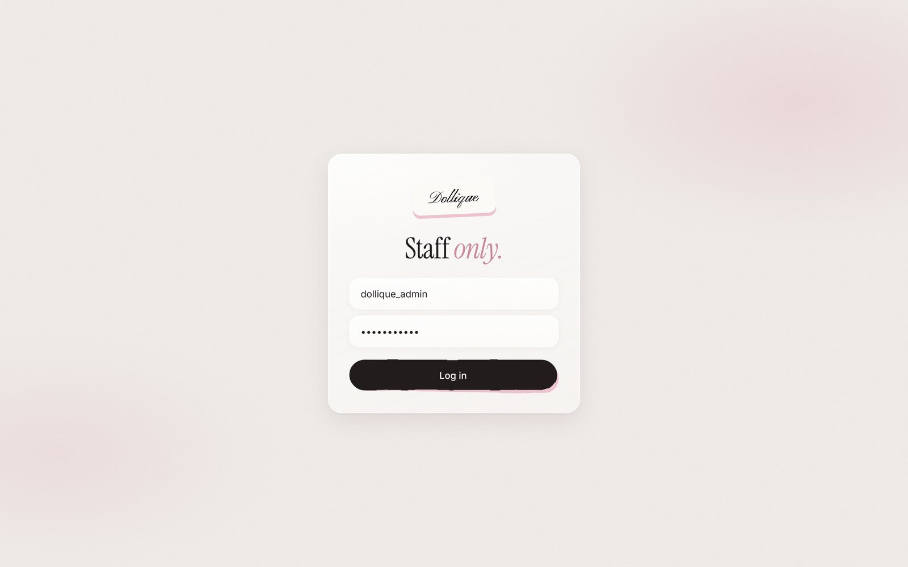 | 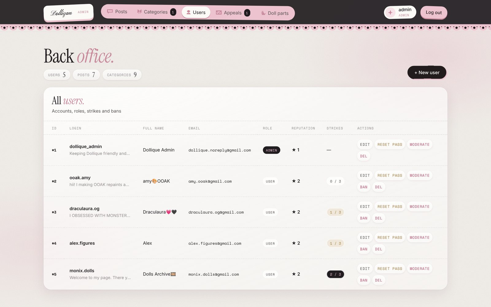 |
| Login | Users, roles, rating and strikes |
| 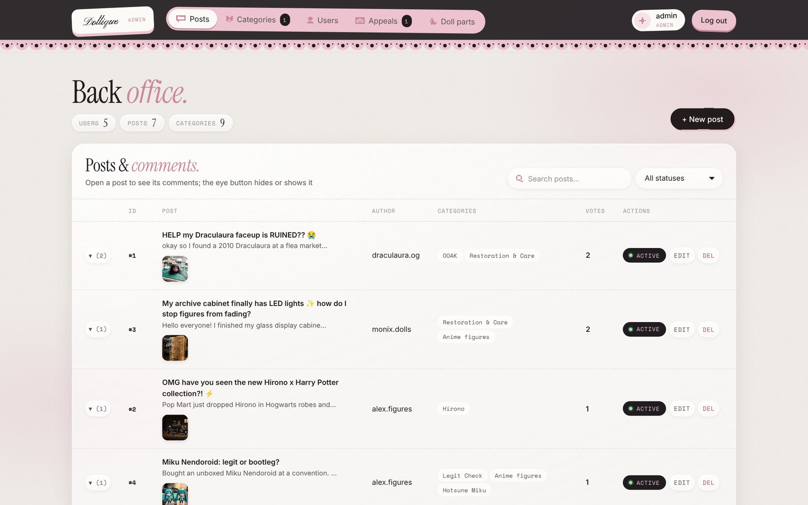 | 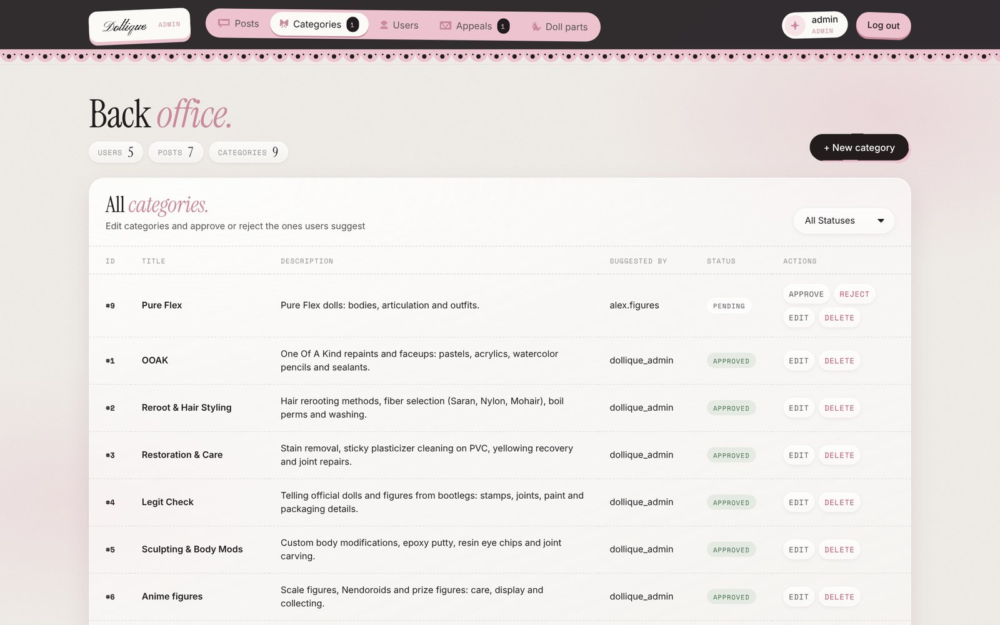 |
| Posts and comments | Categories, including user suggestions |
| 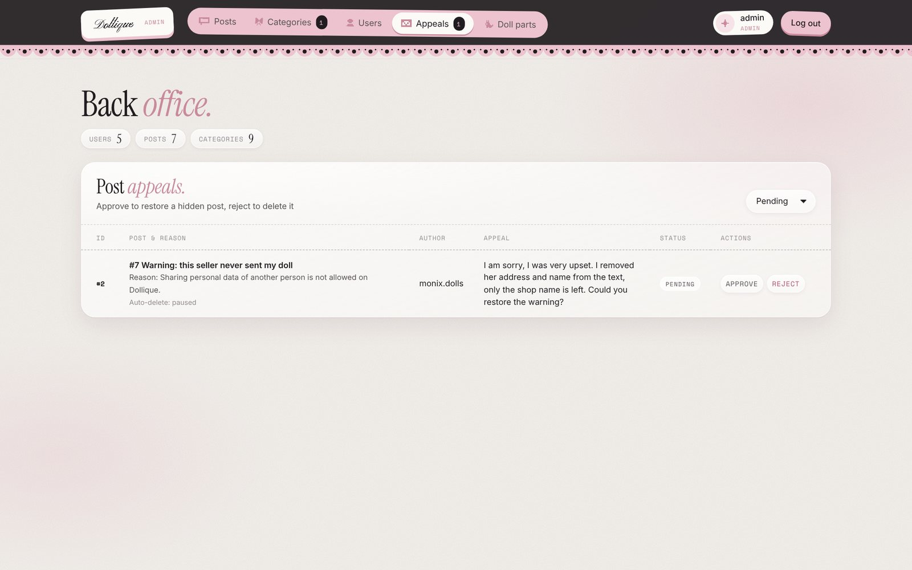 | 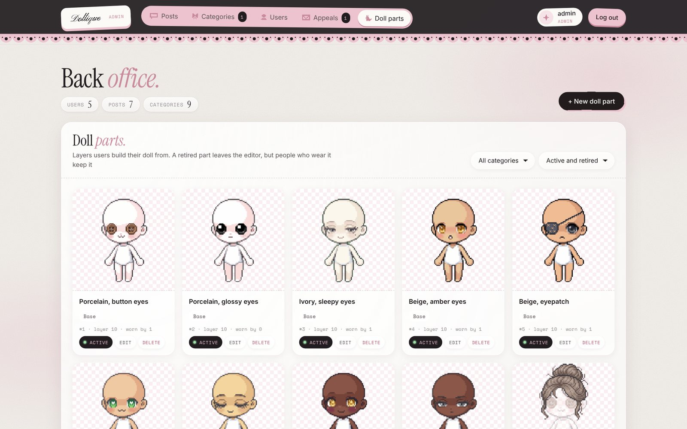 |
| Appeals against moderation | Doll parts catalog |

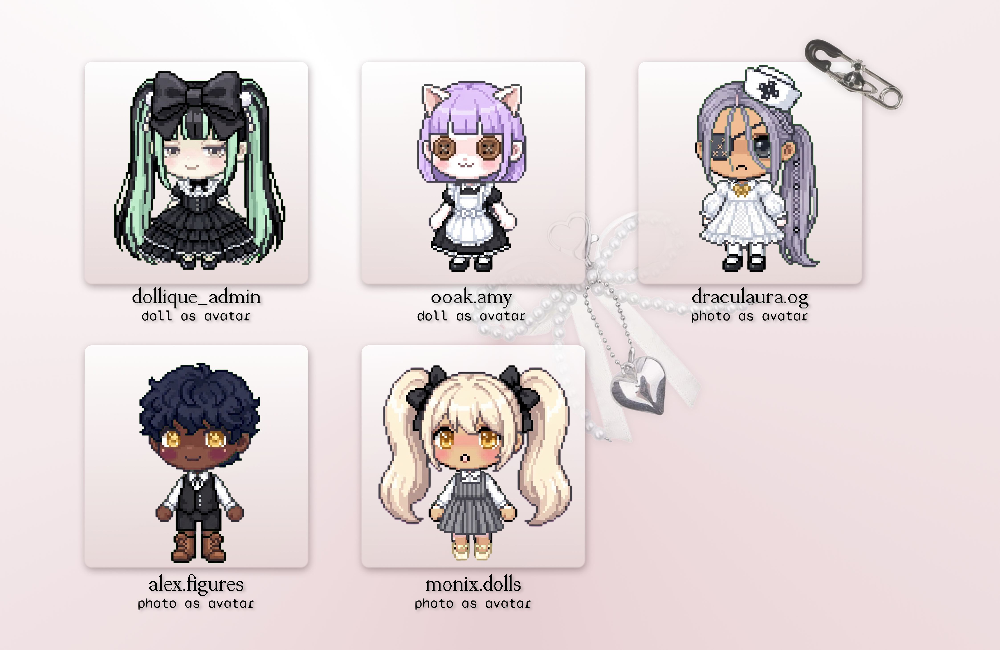

---

## Tech stack

| Part | Choice |
| :--- | :--- |
| Frontend | React 19, Redux Toolkit, React Router 7, `fetch`, plain CSS |
| Build tool | Vite 8 (dev server on port 5173 with a proxy to the API) |
| Backend | Node.js, Express 5 |
| Database | MySQL 8 via `mysql2/promise`, plain SQL |
| Auth | `jsonwebtoken` (JWT) + `bcrypt` |
| Uploads | `multer` (files stored in `API/uploads/`) |
| Email | `nodemailer` (Gmail SMTP, or an Ethereal test inbox when SMTP is not set) |
| Live updates | Server-Sent Events (built into the browser, no extra library) |

---

## Requirements

- [Node.js](https://nodejs.org/) 22.12 or newer (20.19+ also works) with npm
- MySQL 8 running locally (MariaDB 10.6+ works too)
- Git

---

## How to run

### 1. Clone and install

```bash
git clone https://github.com/nntrwx/dollique.git
cd dollique
npm install            # website dependencies
npm run api:install    # API dependencies (inside API/)
```

### 2. Configure the API

Copy `API/.env.example` to `API/.env` and fill in your MySQL password and a JWT secret:

```env
PORT=3000
DB_HOST=localhost
DB_PORT=3306
DB_USER=root
DB_PASSWORD=your_mysql_password
DB_NAME=dollique_db
JWT_SECRET=your_jwt_secret_key_here
FRONTEND_URL=http://localhost:5173   # links in emails open the website pages

# Optional: real emails through Gmail (an app password, not your normal one)
SMTP_USER=your_email@gmail.com
SMTP_PASS=your_gmail_app_password

# Optional tuning
MODERATION_GRACE_DAYS=7      # days before a hidden post is deleted
MODERATION_CHECK_MINUTES=60  # how often the server looks for such posts
BAN_STRIKES=3                # active strikes that ban a user
BAN_DAYS=7                   # length of an automatic ban
```

Without `SMTP_USER` / `SMTP_PASS` everything still works: letters go to a free [Ethereal](https://ethereal.email) test inbox, and the API console prints a link to open each one (`📬 [TEST INBOX] ...`), so you can follow the confirmation or reset link from there.

### 3. Create the database

```bash
npm run api:db
```

This drops and recreates `dollique_db` from `API/database/schema.sql` and fills every table with sample data (14 tables, at least 5 rows each). Sample dates are spread over the last two months.

Sample accounts, all with the password `password123`:

| Login | Role |
| :--- | :--- |
| `dollique_admin` | admin |
| `ooak.amy`, `draculaura.og`, `alex.figures`, `monix.dolls` | user |

### 4. Start

Two terminals in the project folder:

```bash
npm run api   # API on http://localhost:3000
npm run dev   # website on http://localhost:5173
```

- Website: http://localhost:5173
- Admin panel: http://localhost:5173/admin (or http://localhost:3000/admin)
- API: http://localhost:3000/api, health check: http://localhost:3000/api/health

`npm run build` makes a production build of the website in `dist/`.

---

## Project structure

```text
dollique/
├── package.json            # website dependencies and scripts for both parts
├── vite.config.js          # Vite: root web/, dev server 5173, proxy /api, /uploads, /admin to the API
├── web/                    # Part 2: the website
│   ├── index.html
│   ├── public/             # logo, favicon, decorations
│   └── src/
│       ├── main.jsx        # entry: Redux store, router, global styles
│       ├── App.jsx         # routes; pages are loaded lazily
│       ├── api/            # fetch wrapper (client.js), live updates (live.js), doll cache (dolls.js)
│       ├── store/          # Redux: the signed-in user (authSlice.js)
│       ├── components/     # header, footer, post card, comments, doll, dropdown, calendar, dialogs...
│       ├── pages/          # one file per page (+ its CSS)
│       ├── hooks/          # usePolling, useLiveVersion
│       ├── utils/          # validators, dates, votes, doll config, photo shrinking
│       └── styles/global.css
├── API/                    # Part 1: the REST API
│   ├── database/           # db.js (pool), schema.sql, initDb.js (npm run api:db)
│   ├── public/admin/       # admin panel (one HTML file)
│   ├── src/
│   │   ├── app.js          # Express app: middlewares, static files, routes, error handler
│   │   ├── server.js       # entry point: DB check, listen, moderation scheduler
│   │   ├── routes/ controllers/ models/ middlewares/
│   │   ├── services/       # rating, email, tokens, login limiter, moderation, strikes, doll, activity, live
│   │   └── utils/validators.js
│   ├── uploads/            # avatars/, posts/, doll_parts/
│   └── .env.example
└── docs/screenshots/
```

---

## How the website works

**Start.** `main.jsx` mounts the app with the Redux store and the router. `App.jsx` holds the routes; only the feed is in the first bundle, every other page is downloaded the first time it is opened. If a token was saved in `localStorage`, the app loads the user's profile (`GET /api/users/:id`) and puts it into the store.

**Talking to the API.** All requests go through `api/client.js`: a small wrapper around `fetch` that adds `Authorization: Bearer <token>`, sends JSON or `FormData` (photos), and turns an API error into a thrown `Error` with the API's message, which the page shows next to the form or above the post. In development Vite proxies `/api`, `/uploads` and `/admin` to the API, so the browser sees one address.

**Who is signed in.** Redux keeps one thing: the current user (`store/authSlice.js`, with `login`, `logout` and `fetchCurrentUser`). Everything else is loaded by the page that needs it. `PrivateRoute` sends guests to sign in and back after it, `GuestRoute` keeps signed-in users away from the sign in and sign up pages. The header reads the user from the store, so a new login or avatar shows up at once.

**The feed.** All feed settings (sort, order, categories, dates, status, search, page) live in the URL, so a filtered page can be reloaded or shared. When the URL changes, the page builds the query for `GET /api/posts` and renders post cards. Categories with their post counts come from `GET /api/categories`.

**Forms.** Every form checks its fields with `utils/validators.js` (the same rules as the API) when a field loses focus and before sending, so mistakes are shown under the field right away. The API checks everything again; its answer, for example `409` for a taken login, is shown under the right field.

**Posts and comments.** The post page loads the post, its comments and the user's votes. A like or dislike changes the number on screen at once and then goes to the API; clicking the same vote again removes it. Comments are a tree: a reply is a comment with `parent_id`, and the component renders itself for every reply. Photos of a new post are shrunk in the browser before the upload, so they load faster.

**Live updates.** The browser keeps one connection to `GET /api/events` (Server-Sent Events). After any change on the site the API sends a short message like `{ kind: 'comments', path: '/api/posts/5/comments' }`. Pages that show that kind of data reload it quietly, without a loading state. If a message is missed, the pages also check for changes every 8 to 15 seconds and when you come back to the tab.

**The doll.** A doll is a `doll_config` with part IDs. `GET /api/users/:id/doll` returns its pictures in drawing order, and `DollFigure` stacks them on top of each other. Dolls are cached per user, so a feed full of avatars asks for each doll only once. The dress-up editor changes the config and shows the result at once.

**Admin.** Admin actions on the site use the same API as the admin panel: hide or restore a post with a reason, change its categories, delete posts and comments, ban users, approve or reject categories and appeals. The admin panel (`API/public/admin`) is a separate page with tables for all data.

---

## How the API works

**A request.** The request is handled by `app.js`: CORS and JSON parsing are done before routing. Once the route is called, the process starts with middleware execution in which `authMiddleware` checks the JSON Web Token (JWT), `optionalAuthMiddleware` extracts the token once it exists to get different results for both guests and authenticated users in the same route; `roleMiddleware` grants access to the administrator only; and `uploadMiddleware` stores files that have been uploaded using Multer. Then, the controller handles validation of the data and the possible actions, the model performs SQL queries, and JSON response is returned. After a successful change, `announceChanges` tells the open browser tabs about it through `GET /api/events`.

**Registration and login.** In the process of registration, the password is hashed with bcrypt, the confirmation token is created randomly and the email with a link to confirm it is sent to the user. Login can take place only after confirming the email. After successful login, the JSON Web Token is generated for 24 hours, which contains the `token_version` of the user. Logging out and resetting the password result in increasing `token_version`, which makes all tokens previously generated invalid immediately. In case of multiple login failures from one IP-address, the login is blocked for 15 minutes. A new email from the settings is saved as `pending_email` and replaces the old one only after the link in the letter is opened.

**Posts and visibility.** `GET /api/posts` builds a single SQL query depending on the selected filter – categories, period, and status. As a result, the obtained dataset is sorted according to the balance of likes (or according to the dates) and then paginated. According to the rules of access control, guests see only active posts, authors are allowed to see their inactive posts, and administrators can see all posts. In addition, the principle of access control applies to associated objects such as comments, likes, and post categories.

**Votes and rating.** The vote means a row in the `likes` table. A unique key allows users to place one vote per post and one per comment. Voting again switches the vote between like and dislike. After every vote, the `RatingService` updates the author's rating which equals the difference between likes and dislikes of the author's posts and comments.

**Moderation.** Whenever an admin hides a post, an explanation and a date of removal will be added to the post, and the writer will get a notification. An appeal can be submitted by the writer, but only one appeal is allowed at any particular time; every admin is notified about a new appeal and can approve or reject it in the admin panel or right on the post page. If an appeal is granted, the post is restored; if it is rejected, the post is deleted at once. A hidden post gives a strike only when it is really deleted (appeal rejected or no appeal in time), so a hide alone can't ban someone before they had a chance to appeal. There is a scheduler in `server.js` that deletes the post once its lifespan ends.

**The doll.** `DollService` checks whether a `doll_config` is valid or not. In particular, it checks that there is a body, each ID refers to an existing item and is from a certain category, the amount of accessories does not exceed three, and retired parts can be kept only by users who already wear them; nobody new can pick them. For requesting a doll, the service gets all the parts and sorts them according to `layer`. The drawing order (layer) is: base (10), hair and shoes (20), outfits (30), accessories (50); higher layers are drawn on top. Also, a part which is currently worn cannot be deleted, only retired.

---

## Database

| Table | What it stores |
| :--- | :--- |
| `users` | accounts, role, rating, profile picture, `doll_config`, `use_doll_as_avatar`, bio, ban, `pending_email` |
| `tokens` | email confirmation, email change and password reset tokens |
| `categories` | categories with status `pending` / `approved` / `rejected` |
| `category_subscriptions` | who follows which category (the "For you" feed) |
| `posts` | posts with status `active` / `inactive` and moderation fields |
| `post_categories` | many-to-many link between posts and categories |
| `post_images` | up to 5 images per post |
| `comments` | comments and replies (`parent_id`), status `active` / `inactive` |
| `likes` | likes and dislikes on posts or comments |
| `favorites` | saved posts |
| `notifications` | messages to users |
| `appeals` | appeals against hidden posts |
| `violations` | strikes used by the auto-ban |
| `doll_parts` | the doll layer catalog |

Integrity rules live in the schema: foreign keys with `ON DELETE CASCADE` (deleting a user removes their posts, comments and votes), unique `login`, `email` and category `title`, and unique `(author_id, post_id)` / `(author_id, comment_id)` in `likes`, so one person can vote only once per post or comment.

---

## API reference

All bodies are JSON unless the endpoint uploads a file (`multipart/form-data`). Protected endpoints need `Authorization: Bearer <token>`. Errors come back as `{ "error": "..." }` with a matching HTTP status.

### Auth `/api/auth`
| Method | Endpoint | Description | Access |
| :--- | :--- | :--- | :--- |
| POST | `/register` | Register: `login, password, password_confirmation, email`, optional `full_name`, `doll_config`, `use_doll_as_avatar` | Public |
| GET / POST | `/confirm-email/:confirm_token` | Confirm the email from the letter (also confirms a changed email) | Public |
| POST | `/login` | Log in with `login` or `email` + `password` (email must be confirmed) | Public |
| POST | `/logout` | Log out: all tokens of the user stop working | User |
| POST | `/password-reset` | Send a reset link to `email` | Public |
| GET / POST | `/password-reset/:confirm_token` | GET checks the link, POST sets `password, password_confirmation` | Public |

### Users `/api/users`
| Method | Endpoint | Description | Access |
| :--- | :--- | :--- | :--- |
| GET | `/` | All users, each with `posts_count` (published posts) | Public |
| GET | `/:user_id` | One user (email and ban only for the user themselves and admins) | Public |
| GET | `/:user_id/doll` | The user's doll as ordered layers + `use_doll_as_avatar` | Public |
| POST | `/` | Create a user or admin: `login, password, password_confirmation, email, role` | Admin |
| PATCH | `/avatar` | Upload a profile picture (field `avatar`) | User |
| PATCH | `/:user_id` | Update `login, full_name, email, bio, doll_config, use_doll_as_avatar` (`role` for admins). A new email from the user waits for confirmation | Owner / Admin |
| DELETE | `/:user_id` | Delete the account | Owner / Admin |
| POST | `/:user_id/profile-reset` | Reset `fields` (`profile_picture`, `full_name`, `bio`) with a `reason` | Admin |
| GET | `/:user_id/violations` | Strike history | Owner / Admin |
| POST / DELETE | `/:user_id/ban` | Ban (`days`, `reason`) / unban | Admin |

### Posts `/api/posts`
| Method | Endpoint | Description | Access |
| :--- | :--- | :--- | :--- |
| GET | `/` | Posts. Query: `page`, `limit`, `sort=likes\|date`, `order=desc\|asc`, `search`, `categories=1,2`, `date_from`, `date_to`, `status=active\|inactive`, `author=userId`, `feed=subscriptions` ("For you", needs sign-in) | Public |
| GET | `/favorites` | My saved posts | User |
| GET | `/:post_id` | One post | Public* |
| POST | `/` | Create: `title, content, categories`, up to 5 files in `images` | User |
| PATCH | `/:post_id` | Author edits `title, content, categories, status`; photos as `multipart/form-data`: `keep_images` (JSON list of current photos to keep) + new files in `images`, 5 in total. Admin changes `categories` or hides / restores with a `reason` | Author / Admin |
| DELETE | `/:post_id` | Delete | Author / Admin |
| POST | `/:post_id/appeal` | Appeal a hidden post with a `message` | Author |
| POST | `/:post_id/favorite` | Save / unsave | User |
| GET | `/:post_id/categories` | Categories of the post | Public* |
| GET / POST / DELETE | `/:post_id/like` | List votes / vote (`type: like\|dislike`) / remove my vote | Public* / User |
| GET / POST | `/:post_id/comments` | List comments / add one (`content`, optional `parent_id` for a reply) | Public* / User |

\* An inactive post and everything attached to it answers `404` to everyone except its author and admins.

### Comments `/api/comments`
| Method | Endpoint | Description | Access |
| :--- | :--- | :--- | :--- |
| GET | `/:comment_id` | One comment | Public* |
| PATCH | `/:comment_id` | Author edits `content`; author or admin changes `status` (`active` / `inactive`) | Author / Admin |
| DELETE | `/:comment_id` | Delete | Author / post author / Admin |
| GET / POST / DELETE | `/:comment_id/like` | List votes / vote / remove my vote | Public* / User |

### Categories `/api/categories`
| Method | Endpoint | Description | Access |
| :--- | :--- | :--- | :--- |
| GET | `/` | Approved categories (admins see all, authors also see their own suggestions), each with `posts_count` and `followers_count` | Public |
| GET | `/subscriptions` | Ids of the categories I follow: `{ categoryIds }` | User |
| GET | `/:category_id` | One category | Public |
| GET | `/:category_id/posts` | Posts in the category | Public |
| POST | `/` | Create: `title, description`. From an admin it is approved at once, from a user it becomes a `pending` suggestion | User / Admin |
| PATCH | `/:category_id` | Edit, or approve / reject with `status` and `reason` | Admin |
| DELETE | `/:category_id` | Delete | Admin |
| POST / DELETE | `/:category_id/subscribe` | Follow / unfollow an approved category | User |

### Doll parts `/api/doll-parts`
| Method | Endpoint | Description | Access |
| :--- | :--- | :--- | :--- |
| GET | `/` | Catalog, `?category=base\|hair\|outfit\|shoes\|accessory`. Admins also see retired parts and how many users wear each | Public |
| GET | `/:part_id` | One part | Public |
| POST | `/` | Add a part: transparent PNG in `image`, `name`, `category`, optional `layer`, `is_active` | Admin |
| PATCH | `/:part_id` | Edit or retire (`is_active: false`) a part | Admin |
| DELETE | `/:part_id` | Delete a part nobody wears | Admin |

### Appeals, notifications and live updates
| Method | Endpoint | Description | Access |
| :--- | :--- | :--- | :--- |
| GET | `/api/appeals` | All appeals | Admin |
| GET | `/api/appeals/:appeal_id` | One appeal | Author / Admin |
| PATCH | `/api/appeals/:appeal_id` | Decide: `status` (`approved` / `rejected`), `admin_response` | Admin |
| GET | `/api/notifications` | My notifications | User |
| PATCH | `/api/notifications/read-all` | Mark all as read | User |
| PATCH | `/api/notifications/:notification_id/read` | Mark one as read | User |
| DELETE | `/api/notifications/:notification_id` | Delete one | User |
| GET | `/api/events` | Server-Sent Events: `{ kind, path }` after every change on the site | Public |

### Example: a profile doll

A doll is stored as part IDs, `{"base":3,"hair":27,"outfit":14,"shoes":28,"accessories":[33]}`, and the API returns its pictures in drawing order. The website stacks them on top of each other, first one at the bottom.

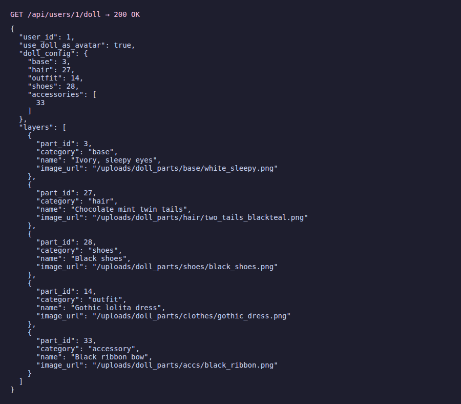

---

## Progress by CBL stages

### Part 1: the API

**Engage.** I chose a niche that interests me and that I thought would make an unusual idea: doll customizing and figure collecting. Generic Q&A sites don't handle this community well: questions about materials, repaints and authenticity get lost, and good answers are hard to find. So the idea became a Q&A platform where the community votes useful answers up.

**Investigate.** I studied the USOF requirements and broke them into entities: users, posts, categories, comments, likes. Then I designed the relational schema with foreign keys and unique constraints and chose the stack: Express, MySQL with `mysql2` and plain SQL, following the MVC structure required by the task.

**Act.**
1. Base API: authentication with email confirmation, CRUD for all entities, likes, rating, sorting, filters and pagination.
2. Access rules for inactive content, admin panel, seed data in every table.
3. Moderation flow: hidden posts with reasons, notifications, appeals, automatic deletion, user-suggested categories.
4. Strikes and auto-ban, profile reset by admins, security fixes: token revocation, login limiter, safer uploads.
5. Creative feature: the profile doll. I created the part images, built the catalog with admin management, and added the option to use the doll instead of the profile picture.

### Part 2: the website

**Engage.** The API already worked, but nobody would use it from Postman. The goal was a website that feels like a cozy corner for doll people, not a generic forum: a place where it is pleasant to ask a question and where your doll greets other members.

**Investigate.** I listed the pages the task asks for (feed, post, profile, auth pages, admin tools) and the user stories behind them. I collected a moodboard (lace, washi tape, pixel art, frosted glass), designed the pages in Figma and picked the stack allowed by the task: React, Redux Toolkit, React Router and plain CSS, built with Vite. While planning I found what the API was missing for the interface: a filter by author, post counts for categories and users, editing post photos, private fields in profiles.

**Act.**
1. Project setup: `web/` and `API/` in one repository, Vite with a proxy to the API, routing and the Redux store for the signed-in user.
2. Auth pages: sign in, sign up with the dress-up doll, email confirmation, password reset.
3. The feed with sorting, filters in the URL, pagination and post cards; the post page with votes, comments and replies; the post editor with photos.
4. Profiles, members, categories with follows and the "For you" feed, settings, notifications.
5. Admin tools on the site, moderation and appeals on the post page; the admin panel restyled like the site.
6. Small API additions the interface needed (each one only adds to Part 1): author filter, counts, photo editing, subscriptions, notifications about activity, email change with confirmation, live updates with Server-Sent Events.
7. Polishing: responsive layout from 360 px, accessibility (Lighthouse 96/100), speed (lazy pages, smaller photos, no blur on cards), live demo checks.

**Next steps.** Community challenges with voting, a wardrobe of doll parts drawn by members, a marketplace for customs and doll clothes, and a PWA with push notifications.
